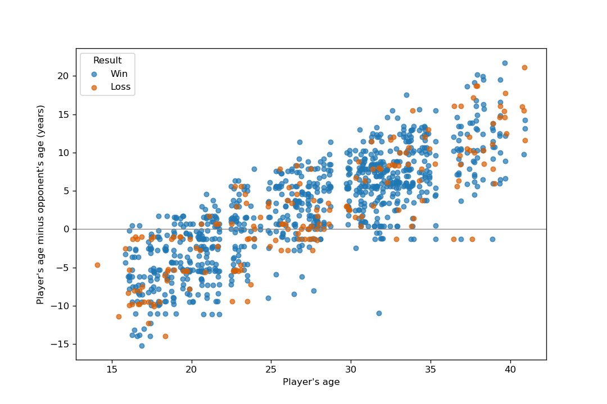
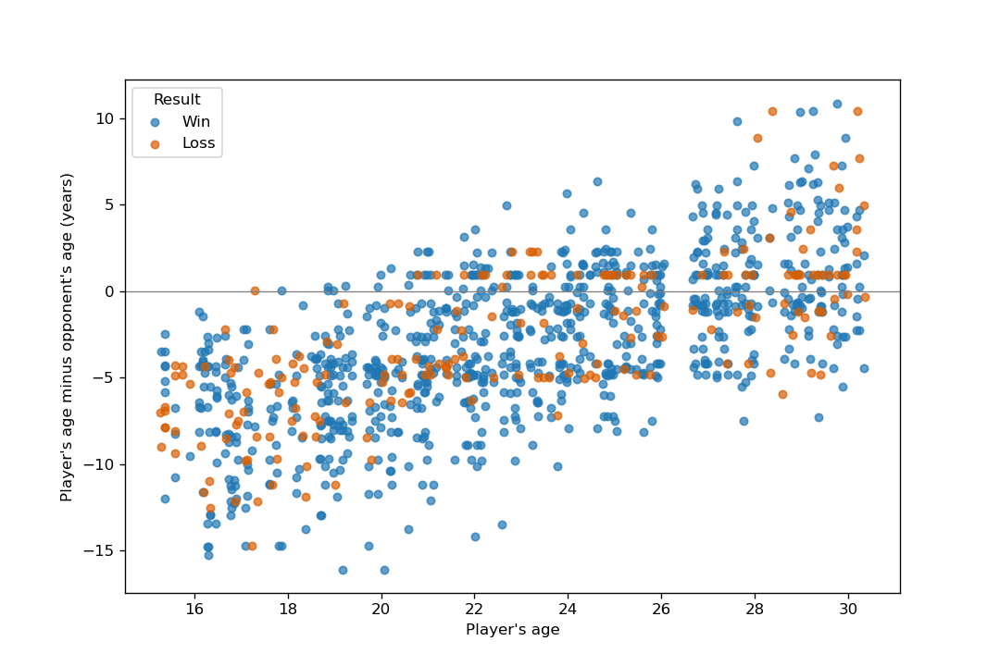

# Tennis Age Gap

A Python package that retrieves a tennis player's career match records from Tennis Abstract and plots the player's age relative to each opponent.

Created for UC Berkeley STAT 159 HW3. Serena Williams and Rafael Nadal are the featured examples, but the package works for other players on the site.

## Installation

Install directly from GitHub:

```bash
pip install git+https://github.com/UCB-stat159-f26/hw03-3-lisaliem7.git
```

The repository is private, so installation requires GitHub authentication with access to it. Do not put access tokens in scripts.

## Public functions

### Retrieve matches

```python
from tennisage import get_player_matches

serena = get_player_matches("Serena Williams")
serena.head()
```

Spaced and CamelCase names are supported:

```python
serena = get_player_matches("serena williams")
serena = get_player_matches("Serena Williams")
serena = get_player_matches("SerenaWilliams")

rafa = get_player_matches("Rafael Nadal")
```

An unknown player produces a meaningful error:

```python
get_player_matches("GastonSanchez")
# ValueError: No player found for 'GastonSanchez'. Check the spelling, e.g. 'Serena Williams'.
```

The returned data frame contains:

| Column | Meaning |
|---|---|
| `date` | Match date supplied by Tennis Abstract |
| `opponent` | Opponent's name |
| `player_age` | Player's age in decimal years |
| `opp_age` | Opponent's age in decimal years |
| `age_diff` | Player age minus opponent age |
| `won` | True for a win, False for a loss |

Ages derived from birth dates use elapsed days divided by 365.25. Opponent ages that the site already gives as numbers are used as they are. Rows without a usable opponent age are dropped.

### Plot matches

```python
from tennisage import plot_age_gap

fig = plot_age_gap(serena)
```

The horizontal axis shows the player's age. The vertical axis shows player age minus opponent age:

- Positive values: the player was older.
- Negative values: the player was younger.
- Zero: the players were the same age.

Blue points are wins and orange points are losses. The function returns a matplotlib figure, which can be saved like this:

```python
fig.savefig("serena_plot.png", dpi=150)
```

If the data frame did not come from `get_player_matches`, the function raises a `ValueError`.

## Serena Williams example



The data frame has 1,038 matches dated October 30, 1995, through August 29, 2022. These are the records the website returned when I ran the package, not a verified count of every match she played.

## Rafael Nadal example



The data frame has 1,096 matches dated September 10, 2001, through October 10, 2016. His file ends well before his career did, which is described below.

## Data retrieval and limitations

The package turns a player's name into the format the website uses, so "serena williams" becomes "SerenaWilliams". It downloads that player's career file and reads the list of matches inside it. The career file does not contain the player's own birth date, so the package reads it from the player's page on the same site.

Women's files store each opponent's birth date, and men's files store each opponent's age. The package checks which format each row uses and converts both into an age in years.

Coverage varies between players. Serena Williams's file runs through her retirement in 2022, but Rafael Nadal's file stops in October 2016. The package does not check whether a file contains every match a player has ever played. The dates may be tournament dates rather than the exact day of each match, so the ages are approximate. If the website changes its format, the retrieval code will need to be updated.

## Testing

Install the testing tools and run the suite from the repository root:

```bash
pip install -e ".[test]"
pytest
```

The automated tests use small mock career files for a female player and a male player, so they do not contact the live website. They cover parsing the match list, selecting columns, opponent ages in both formats, reading a birth date, building the final data frame, converting names, and the plot's labels and input check. The functions that download data were checked by hand against the live site.

## Personal reflections

A download that works does not mean the data is complete. Nadal's career file stops in October 2016 even though he kept playing for years afterward, so I describe that limit in this README instead of leaving it out.

Splitting the work into small functions helped more than I expected. The women's and men's files store opponent information differently, and each difference ended up in one small function that I could test on its own. When something broke, I knew where to look.

Writing tests with mock files meant I never had to contact the website while testing, and the whole suite runs in under a second. Getting set up was the hardest part for me. Cloning the repository failed because `gh` was not installed and my token did not work at first, so I learned to read each error message carefully. I got more comfortable making small commits and checking that they reached GitHub.

## Dependencies and development

Runtime dependencies are declared in `pyproject.toml`: pandas, requests, and matplotlib. The testing tool pytest is an optional dependency.

As specified in HW3, this package does not need a Makefile or an `environment.yml` file.

## Sources and license

- Data: [Tennis Abstract](https://www.tennisabstract.com)
- Visualization reference: the New York Times Serena Williams age comparison from HW2. The plot uses the same idea without the annotations.

Package code is released under the MIT license. The code license does not grant rights to third-party data or graphics.
